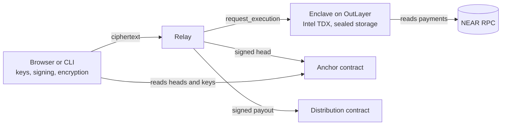

# Undiluted

[](https://github.com/Elioz404/Undiluted/actions/workflows/ci.yml)

A confidential cap table that runs itself. Each investor sees only their own
stake, yet can prove the total adds up and that nothing changed behind their
back. Rounds take money and issue SAFEs without the founder in the loop, rights
like MFN exercise themselves, and an exit pays everyone out with one approval.

Built for NEAR HACKATHON (November 2026). Runs on NEAR testnet.

**Try it live:** https://elioz404.github.io/Undiluted/ (the relay sleeps when idle,
so the first action can take a minute). Press **Verify the enclave** to check its
Intel TDX attestation in your browser, then **Start a demo company**.

## The problem

A startup's cap table is a private spreadsheet or a vendor database. Investors
have to trust whoever keeps it: nobody can check that a later SAFE got better
terms in secret, that a payment really arrived, or that the table they were shown
is the one everyone else sees. Putting it on a public chain fixes the trust and
breaks the privacy: every investor, amount and term would be public.

Undiluted keeps the table inside a TEE, publishes only a commitment to its
history on NEAR, and lets the rules act on their own:

| Who | Can do | Cannot do |
| --- | --- | --- |
| Company | Read the full table, open a round, issue SAFEs against real payments, approve an exit | Issue a SAFE for a payment that never happened, reuse a payment, change history, block an MFN election, redirect a payout |
| Investor | See their own lines, verify the total and the history against NEAR, subscribe to an open round alone, adopt better terms through MFN, choose where to be paid | See any other investor, their amounts or their terms |
| Anyone | Read an open round's terms, relay transactions | Forge a head, claim someone else's payment, alter or repeat a payout |

## Money with a mind of its own

Three things happen without anyone approving them each time:

- **The round runs itself.** The founder signs a round's limits once: SAFE terms,
  smallest check, round size. From then on an investor pays, signs, and the
  enclave records their SAFE if the payment is real and the round has room. The
  payment's memo names the investor's key, so nobody watching the treasury can
  claim it.
- **Rights enforce themselves.** When a later SAFE gets better terms, an MFN
  holder sees an offer in their statement, without learning who got those terms
  or for how much, and adopts them alone. The company cannot block it.
- **Exits pay out on their own.** The board approves a sale once. The enclave
  works out the waterfall and signs each payout. A contract holds the proceeds in
  a distribution that belongs to whoever funded it, and pays only what is signed,
  each payment once, never more than was deposited.

## Try it in two minutes

Needs [Rust](https://rustup.rs). The toolchain is pinned in `rust-toolchain.toml`
and installs itself. Without a local Rust toolchain, run the same commands in
Docker by prefixing them with `docker run --rm -v "$PWD:/work" -w /work rust:1.99.1`
(in Git Bash on Windows, set `MSYS_NO_PATHCONV=1` first so the path is not rewritten).

```bash
cargo run -p undiluted-cli -- demo local
```

This runs the real enclave code in-process, with no account, key or network. It
proves the rules; the testnet deployment below adds the confidentiality. You
will see, in order:

1. The company and three holders register, each proving their own key.
2. Ana pays and gets an uncapped MFN SAFE. Ben pays and gets a capped SAFE.
3. Three forged SAFEs are refused: an invented payment, a reused one and an
   inflated one.
4. Ana's statement offers her Ben's better terms without naming Ben, and she
   adopts them alone.
5. The founder opens a round. Someone tries to claim Ben's payment and is refused
   because the memo names Ben's key. Ben subscribes and the enclave records it
   with no founder signature.
6. Ben is refused the full table, an impostor is refused Ben's statement, and
   Ben's head matches the published one. A forged head is refused.
7. The company is sold for $10. Each payout follows the waterfall, adds up to
   the exact proceeds, and a stolen or inflated payout is refused.

Run every test:

```bash
cargo test --workspace
```

## Check each claim

| Run | What it shows |
| --- | --- |
| `cargo test -p undiluted-domain conversion` | SAFEs convert to the share counts worked out by hand in each test comment |
| `cargo test -p undiluted-domain waterfall` | Who takes their money back and who converts at small, medium and large exits, always adding up to the exact proceeds |
| `cargo test -p undiluted-domain mfn` | A later SAFE with better terms lets an earlier MFN holder adopt them |
| `cargo test -p undiluted-ledger` | Altered, removed or forged entries are rejected; a round enforces its terms, smallest check and size; a rewritten history no longer matches the head a holder kept |
| `cargo test -p undiluted-envelope` | Only the enclave opens a request, only the sender opens the reply, and tampering is detected |
| `cargo test -p undiluted-service` | Who may do what; a retried request does not act twice; a SAFE cannot rest on an invented, reused, redirected or inflated payment; a subscription needs a payment whose memo names its key |
| `cargo test -p undiluted-client` | Answers lost on the way back do not apply anything twice |
| `cargo test -p undiluted-anchor` | A head needs the enclave's signature and cannot be overwritten or skipped |
| `cargo test -p undiluted-distribution` | A relay cannot change a payout, repeat one, or pay more than was deposited |

## The web app

A company console and an investor view in the browser. Keys are made and kept in
the browser; requests are signed and encrypted there by the same Rust code,
compiled to WebAssembly. A small relay forwards ciphertext to the enclave and
pays for transactions; it never sees a key or a position, and it cannot stand in
for the enclave:

- The site pins the enclave's signing key and wasm hash at build time, from the
  public settings in `web/.env.production`. That key signs the enclave's
  encryption key, so a relay cannot hand out a key of its own.
- **Verify the enclave** checks, in the browser, the Intel TDX attestation of the
  run that produced those keys. See [Verify the enclave yourself](#verify-the-enclave-yourself).
- **Check against NEAR** reads the head, and the enclave key the company
  registered, from NEAR's RPC directly, not through the relay.
- The relay pays for everything from its own test funds, so it rate limits each
  address, caps each payment and exit, and keeps one daily budget for everyone.
  It relays a payout only after the contract confirms the enclave signed it.

To run it locally you need Node 24, `wasm-bindgen-cli` 0.2.130 and a funded
testnet account for the relay:

```bash
cargo install wasm-bindgen-cli --version 0.2.130 --locked
cd web && npm ci && sh scripts/build-wasm.sh
cp .env.example .env.local   # set RELAY_ACCOUNT and RELAY_PRIVATE_KEY
npm run dev
```

Open http://localhost:5173 and:

1. Press **Start a demo company**. The company console opens with the founder's
   stock already recorded on chain.
2. Press **Check against NEAR** under the table. The head shown matches the one
   the anchor contract holds.
3. In **Next steps**, open the **Round** tab and open a round.
4. From **Investors**, open Ben's view in a new tab. Ben is not on the cap table.
   In the **Round** tab, press **Pay and subscribe**: Ben pays test USDC with a
   memo naming his key, signs, and his SAFE appears. Back in the console, press
   **Refresh**: Ben is on the table, and nobody approved it.

Each step is a real enclave run on testnet, so it takes several seconds. The
whole flow also runs headless against a relay:

```bash
cd web && RELAY_URL=http://localhost:8080 npx tsx --env-file=.env.local scripts/e2e.ts
```

It creates a company, invites Ana, issues her SAFE against a real payment, opens
a round that Ben joins alone while someone else's claim on his payment is
refused, sells the company, and pays everyone out through the distribution
contract, where a forged payout is refused before the relay spends anything.

## Verify the enclave yourself

The claim that matters most is that the table lives in a genuine TEE running this
code. Every OutLayer run is attested: Intel signs a TDX quote whose report data
commits to the run's wasm hash, input and output. The check takes four steps, all
in `crates/attestation`, on public evidence only:

1. The quote is signed by Intel's attestation chain and the platform is up to
   date, checked with [dcap-qvl](https://github.com/Phala-Network/dcap-qvl)
   against the Intel collateral OutLayer keeps on NEAR.
2. The quote's five measurements (MRTD, RTMR0-3) are a worker image OutLayer
   approved on NEAR, in its register contract.
3. The quote's report data is the hash of the run's details, so none can be swapped.
4. Those details name this repository's enclave wasm, and their output hash is the
   hash of the output NEAR recorded: the enclave's identity, with the signing key
   the site pins.

From the command line:

```bash
cargo run -p undiluted-cli -- verify-enclave --transaction 8V4dn4gEfMvitRvFQaXtQAmJKXo6izN4gsk31z3uYzBL --sender undiluted-dev.testnet --wasm-hash c3b8b92a101e575d1c0e2e502c1fc21443fa0e08e864e84fe467d5840bda9f77 --rpc-url https://rpc.testnet.fastnear.com --attestation-api https://testnet-api.outlayer.ai --register-contract worker.outlayer.testnet
```

It prints the platform status, the approved measurements, the wasm and the keys.
In the web app, **Verify the enclave** on the first page runs the same Rust code,
compiled to WebAssembly, and shows **Genuine enclave** when every step holds.
`cargo test -p undiluted-attestation` runs it against a recorded testnet
attestation, and shows that another wasm, an altered output, a swapped detail, an
unapproved image or a tampered quote are each refused.

To check that the wasm hash is this code, build it and compare:

```bash
docker run --rm -v "$PWD:/work" -w /work/crates/enclave rust:1.99.1 sh -c "cargo build --release --target wasm32-wasip2 --target-dir /tmp/build && sha256sum /tmp/build/wasm32-wasip2/release/undiluted-enclave.wasm"
```

### The page itself

A web page is only as trustworthy as whoever serves it. So the site is built by
GitHub Actions from this repository (`.github/workflows/pages.yml`) and published
on GitHub Pages, apart from whoever runs the relay, and the build is attested:

```bash
gh attestation verify index.html --repo Elioz404/Undiluted
```

run on a file downloaded from the published site, shows the workflow and commit it
came from. Everything the page trusts is in `web/.env.production`, and its content
security policy allows scripts only from the site itself.

## Deployed on NEAR testnet

| What | Where |
| --- | --- |
| Enclave (OutLayer project, Intel TDX) | `undiluted-dev.testnet/undiluted`, wasm sha256 `c3b8b92a101e575d1c0e2e502c1fc21443fa0e08e864e84fe467d5840bda9f77` |
| Enclave signing key (pinned by the site) | `4385ac1675dfd32bf15f994b0bd1effead92649d12ad7422b7ab003ef97f6ab4` |
| An attested `identity` run | [`8V4dn4gEfMvitRvFQaXtQAmJKXo6izN4gsk31z3uYzBL`](https://testnet.nearblocks.io/txns/8V4dn4gEfMvitRvFQaXtQAmJKXo6izN4gsk31z3uYzBL) |
| OutLayer register contract (collateral, approved images) | `worker.outlayer.testnet` |
| Anchor contract | [`anchor.undiluted-dev.testnet`](https://testnet.nearblocks.io/address/anchor.undiluted-dev.testnet) |
| Distribution contract | [`distribution.undiluted-dev.testnet`](https://testnet.nearblocks.io/address/distribution.undiluted-dev.testnet) |
| Treasury | [`treasury.undiluted-dev.testnet`](https://testnet.nearblocks.io/address/treasury.undiluted-dev.testnet) |
| Test stablecoins | `usdc.tidepool-sandbox.testnet`, `usdt.tidepool-sandbox.testnet` |

## How it works



- **Every change is a signed event.** The current table is never stored on its
  own; it is the result of replaying the events. Replaying the same events gives
  the same result on any machine, because the rules use integer arithmetic only.
- **Holders co-sign what affects them.** An instrument cannot be issued or changed
  without the holder's signature. The company signs too, except where it granted
  the right in advance: an MFN election, a payout account, a subscription to the
  round it opened.
- **History is chained.** Each entry commits to the previous one, so one digest,
  the head, commits to everything before it without revealing any of it.
- **The table lives in a TEE.** The service runs in an Intel TDX enclave on
  [OutLayer](https://outlayer.ai), with storage only that code can decrypt. Its
  signing key is generated inside the TEE and never leaves it, and it signs the
  encryption key clients use.
- **Messages are encrypted end to end.** Inputs and outputs of on-chain runs are
  public, so each request and reply is encrypted between the client and the
  enclave (X25519, HKDF, ChaCha20-Poly1305) and padded to 1 KiB blocks, so its
  length does not tell which operation it carries. The enclave answers each
  request once; a replayed envelope gets the same reply back, never a new one.
- **Heads are anchored on NEAR.** The anchor contract accepts a head only with
  the enclave's signature, only in order, and never replaces one. An investor
  compares the head in their statement with the published one.
- **Payments are checked on chain.** A SAFE is accepted only if the token's own
  contract logged that exact amount arriving at the treasury, in a final
  transaction, and no other instrument relies on that payment. The company's own
  SAFEs can be paid through the 1Click API from another token; a self-serve
  subscription is paid in the treasury's token on NEAR, because only a direct
  transfer can carry the memo that ties it to the investor.

## Project layout

| Path | Responsibility | Depends on |
| --- | --- | --- |
| `crates/domain` | Instruments, SAFE conversion, MFN, exit distribution | nothing that does I/O |
| `crates/ledger` | Signed hash-chained events that rebuild a cap table, rounds included | `domain` |
| `crates/envelope` | End-to-end encryption between client and enclave | nothing that does I/O |
| `crates/service` | Authorization, proposals, statements, payment checks; storage, signing and the chain are ports | `ledger`, `envelope` |
| `crates/client` | Signs, encrypts and sends requests, verifies replies | `service` |
| `crates/cli` | The runnable demo | `client` |
| `crates/web` | The client protocol for browsers, as WebAssembly | `service` |
| `crates/enclave` | Connects OutLayer's sealed storage, TEE keys and RPC to the service | `service` |
| `contracts/anchor` | Append-only registry of heads on NEAR | `near-sdk` |
| `contracts/distribution` | Holds exit proceeds and pays what the enclave signed | `near-sdk` |
| `web/src` | Company console and investor view (React) | `crates/web` |
| `web/server` | Relay: forwards ciphertext, publishes heads, pays from test funds | `near-api-js` |

`crates/enclave` targets `wasm32-wasip2` only, so it is outside the Cargo workspace.

## Deploying your own

```bash
cd crates/enclave && cargo build --target wasm32-wasip2 --release
```

Upload the wasm with the [OutLayer CLI](https://github.com/out-layer/outlayer-cli),
deploy it as a project, and generate the enclave key inside the TEE so nobody
ever sees it:

```bash
outlayer secrets set --generate PROTECTED_ENCLAVE_KEY:hex32 --project OWNER/PROJECT
```

Build the contracts and deploy them, for example to `anchor.OWNER` and
`distribution.OWNER`, calling `new` on each:

```bash
RUSTFLAGS='-C target-cpu=mvp -C link-arg=-s' cargo build -p undiluted-anchor -p undiluted-distribution --target wasm32-unknown-unknown --release
```

Test payments use [Tidepool](https://www.usetidepool.tech), a community-run
1Click sandbox on testnet. Get free test tokens from its faucet first:

```bash
curl -X POST https://www.usetidepool.tech/v0/faucet -H 'content-type: application/json' -d '{"accountId":"OWNER","mode":"wallet"}'
```

Then run the demo against the deployment:

```bash
cargo run -p undiluted-cli -- demo deployed --project OWNER/PROJECT --secrets-account OWNER --anchor-contract anchor.OWNER --signer OWNER --treasury TREASURY --payment-api https://www.usetidepool.tech --origin-asset nep141:usdt.tidepool-sandbox.testnet --destination-asset nep141:usdc.tidepool-sandbox.testnet --distribution-contract distribution.OWNER --founder-account FOUNDER --ana-account ANA --ben-account BEN
```

The deployed CLI demo pays through 1Click, which cannot attach a memo, so it
skips the self-serve round; the web app runs that step on testnet. The web app
and its relay also ship as one container image: `docker build -t undiluted .`

## Rules and their limits

- SAFEs follow post-money mechanics. A priced round issues whichever of round
  price, cap or discount gives the holder the most shares. Round conversion does
  not model an option pool increase in the round itself.
- Exits are non-participating and pari passu between preferred stock and SAFEs.
  A SAFE with no valuation cap can only take its money back. Unissued options and
  token warrants receive nothing.
- One proposal is open per company at a time, so two investors subscribing at the
  same moment take turns. A subscriber who proposes and never signs holds the
  round until the company withdraws the proposal; their payment stays theirs to
  claim again.
- The browser keeps keys in local storage for its origin, so in this demo the
  company console and an investor view opened in the same browser could read
  each other's keys. Real holders each use their own browser. The page's content
  security policy allows scripts only from the site itself.
- The browser trusts the page it loaded. Pages published by this repository's
  workflow carry a build attestation; a page from anywhere else is only as
  trustworthy as whoever serves it.
- Anyone can read an open round's terms and size. What was raised stays private;
  a subscription that would overflow the round is refused.
- One deployment serves its calls through one relay account, because the
  enclave's storage is bound to the account that signs the call.
- Anchors reveal a company identifier and how many events it has recorded.
- Payments and exit payouts move on chain, so their amounts are public there. What
  stays private is the cap table: who holds what, on which terms.
- The enclave trusts the RPC proxy of the worker it runs on to report
  transactions honestly. Confidentiality depends on the TEE and on OutLayer's
  platform; see [what its operator can and cannot do](https://github.com/out-layer/outlayer/blob/main/docs/NON_CUSTODIAL.md).
  The client checks a run's Intel attestation and OutLayer's approved images, but
  trusts OutLayer's worker image, once approved, to run the wasm it names.
- Test payments run on Tidepool, a third-party sandbox not affiliated with NEAR,
  whose tokens have no value. NEAR Intents has no official testnet.
- The ledger protects what is recorded in it. It cannot stop a founder from
  signing something outside of it.
- Instruments are recorded, not offered. This is not legal advice, and a real
  raise needs legal counsel.

## NEAR HACKATHON

- **Tracks:** Privacy & Private AI, Real-World Money, Autonomous Business, Open
  Innovation.
- **Built in the window:** the repository started on 6 November 2026; all code
  was written during the hackathon.
- **NEAR in it:** an OutLayer TEE runs the service; NEAR contracts anchor every
  head and pay exits only on the enclave's signature; NEP-141 stablecoin transfers,
  read from the token's own logs, back every SAFE; the 1Click API routes
  cross-token payments.

## Third-party code

Built on [near-sdk](https://github.com/near/near-sdk-rs),
[borsh](https://github.com/near/borsh-rs),
[ed25519-dalek and x25519-dalek](https://github.com/dalek-cryptography/curve25519-dalek),
[sha2](https://github.com/RustCrypto/hashes),
[chacha20poly1305](https://github.com/RustCrypto/AEADs),
[hkdf](https://github.com/RustCrypto/KDFs),
[primitive-types](https://github.com/paritytech/parity-common),
[thiserror](https://github.com/dtolnay/thiserror),
[serde](https://github.com/serde-rs/serde),
[wasm-bindgen](https://github.com/rustwasm/wasm-bindgen),
[outlayer](https://github.com/out-layer/outlayer),
[clap](https://github.com/clap-rs/clap) and, for tests,
[proptest](https://github.com/proptest-rs/proptest). The web app uses
[React](https://react.dev), [Vite](https://vite.dev),
[Express](https://expressjs.com) and
[near-api-js](https://github.com/near/near-api-js), with the
[General Sans](https://www.fontshare.com/fonts/general-sans) and
[Geist Mono](https://vercel.com/font) typefaces.

AI coding assistants were used during development. Every change was reviewed,
tested and committed by the team.

## License

[MIT](LICENSE)
